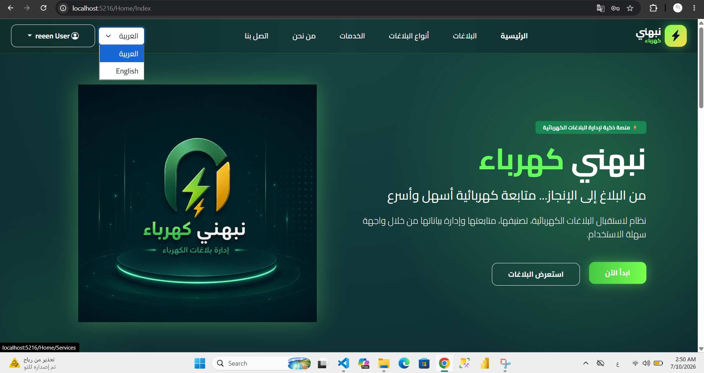
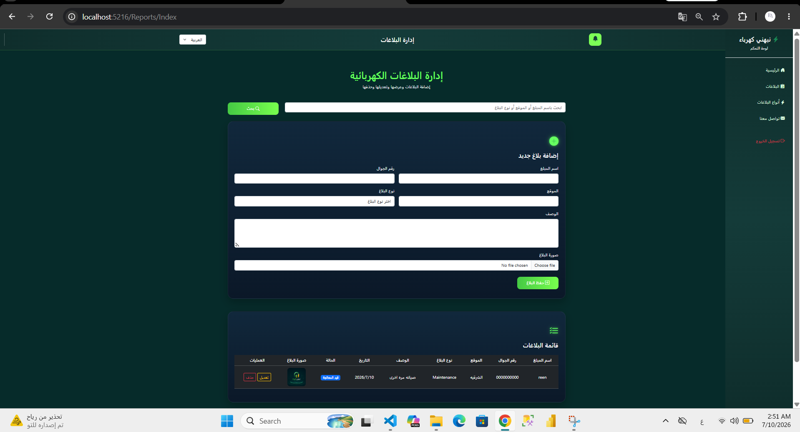
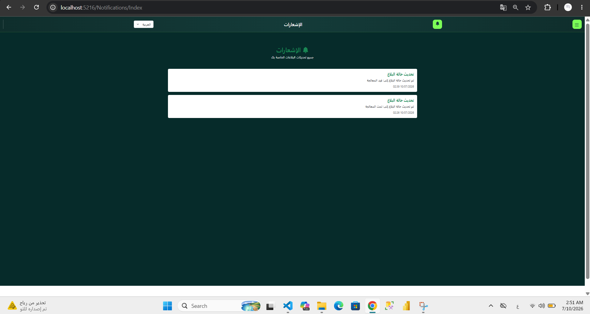
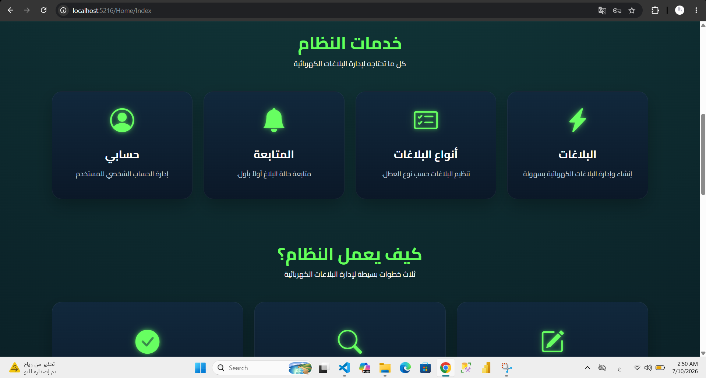
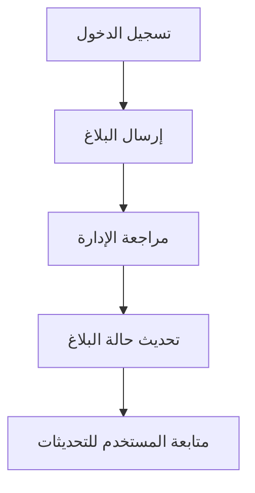

# نبهني كهرباء | Nabihni Electricity

منصة لإدارة البلاغات الكهربائية ومتابعة حالتها، طورتها كمشروعي الختامي في برنامج تطوير تطبيقات الويب باستخدام ASP.NET Core MVC بأكاديمية طويق.

تتيح للمستخدم إرسال البلاغ ومتابعته، وللإدارة مراجعة البلاغات وتحديث حالاتها من خلال صلاحيات منفصلة.

## المميزات

- إنشاء الحسابات وتسجيل الدخول.
- إضافة البلاغات وعرضها وتعديلها وحذفها.
- إرفاق الصور مع البلاغات.
- إدارة صلاحيات المستخدم والإدارة باستخدام ASP.NET Identity.
- متابعة حالات البلاغات والإشعارات.
- دعم العربية والإنجليزية.
## معاينة المنصة

### الصفحة الرئيسية

### إدارة البلاغات

### الإشعارات

### خدمات المنصة

## مسار البلاغ

## التقنيات

C# · ASP.NET Core MVC · Entity Framework Core · SQL Server · ASP.NET Identity · Bootstrap 5 · JavaScript

## تنظيم المشروع

| المجلد | المحتوى |
|---|---|
| Controllers | معالجة الطلبات وإجراءات التطبيق |
| Models | نماذج البيانات |
| Views | واجهات المستخدم |
| Data | سياق قاعدة البيانات |
| Migrations | تغييرات بنية قاعدة البيانات |
| Resources | موارد الترجمة |
| wwwroot | التنسيقات والبرامج النصية والصور |

## إعداد التشغيل

يتطلب المشروع .NET SDK المتوافق مع ملف المشروع وSQL Server.

يُضبط اتصال قاعدة البيانات محليًا، ثم تُستعاد الحزم وتُطبق ترحيلات Entity Framework Core قبل تشغيل التطبيق.

إعداد الاتصال المنشور مثال محلي. تُحفظ كلمات المرور وإعدادات الاتصال الخاصة خارج المستودع باستخدام User Secrets أو متغيرات البيئة.

## المشروع المرتبط

[لوحة تحليل بلاغات نبهني كهرباء باستخدام Power BI](https://github.com/reemBalshammari/Nabihni-Electricity-Power-BI)

---

تطوير: ريم بريكان الشمري  
